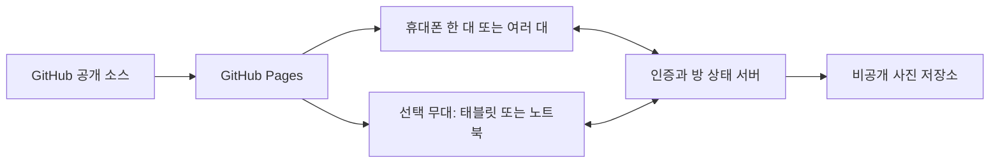

# 생일 정상처리

직원 생일 축하 웹앱 기획서 v0.1 · 2026-11-06

**촛불 하나 끄는데 전 직원이 필요한 생일 파티.**

휴대폰을 흔들면 케이크가 요동치고, 마이크에 불면 촛불이 꺼진다. 마지막 촛불 하나는 잠깐 버티다가 결국 꺼진다. 모든 화면에서 폭죽이 터진 뒤 앱은 진지하게 말한다. “금일 생일 업무 정상 처리.” 그리고 작은 ‘뿍’ 소리가 난다.

이 문서는 구현 전 제안이다. 인원, 시간, 용량, 성능 수치는 설계 목표 또는 초기 설정안이며 실측 결과가 아니다. 실제 직원 정보나 사진은 제공받지 않았고 문서에도 사용하지 않았다.

## 1. 목표와 첫 출시 범위

짧은 사내 생일 축하 자리에서 설치 없이 접속해 함께 웃는 도구를 만든다. 준비를 마친 뒤 본행사는 1~3분을 목표로 한다. QR 입장과 권한 설정 시간은 별도로 측정한다. 다기기 목표 규모는 3~10대이며, 실제 검증한 기기 수까지 지원 범위를 표시한다.

| 사용자 요구 | 첫 출시 동작 |
|---|---|
| 케이크·촛불 | 화면 중앙의 젤리 같은 케이크, 점화·흔들림·소등·연기 |
| 센서 흔들기 | 휴대폰을 가볍게 흔들면 케이크와 장식이 흔들리고 공동 준비 게이지에 기여 |
| 마이크로 불기 | 지정 기기의 마이크에서 바람을 추정해 소등에 기여 |
| 폭죽·소리 | 소등 확정 후 각 화면에 폭죽, 지정한 한 기기에 팡파르·짧은 효과음 |
| 이름·생일 입력과 수정 | 진행자가 표시 이름과 생일 월일을 입력·수정하고 참여 화면에 반영 |
| 남녀 구분 | 남성·여성·공통 중 선택, 호칭과 장식 프리셋 변경, 개별 수정 가능 |
| 사진 업로드 | 선택·미리보기·원형 자르기·적용·교체·삭제, 케이크 토퍼로 표시 |
| 여러 기기 연동 | 하나의 방에서 단계·케이크 준비도·촛불 상태·축하 시점을 공유 |
| 태블릿 없이 사용 | 휴대폰 한 대로 전체 진행, 여러 휴대폰만으로 공동 참여 모두 지원 |
| 공개 GitHub | 소스와 배포용 정적 파일을 공개하고 행사 데이터는 별도 비공개 영역에 보관 |
| 쓸데없고 킹받는 재미 | 과장된 케이크 반응, 버티는 촛불, 진지한 행정 말투, 허무한 마무리 |

센서와 마이크는 첫 출시의 필수 범위다. 개발 중 버튼으로 먼저 연결하는 것은 중간 점검이며 최종 기능을 대체하지 않는다. 권한 거절·미지원 기기를 위한 버튼 대안은 계속 제공한다.

직원 명부, 계정 가입 화면, 생일 자동 알림, 인사 시스템 연동, 녹음, 개인별 순위, 음력 변환, 얼굴 인식, 3D 물리 엔진은 초기 범위에서 제외한다. 한 방의 생일자는 한 명으로 시작한다.

## 2. 기기 구성과 역할

| 구성 | 진행 방식 |
|---|---|
| 휴대폰 한 대 | 진행자와 생일자가 기기를 번갈아 사용. 설정부터 흔들기·불기·폭죽까지 단독 모드에서 완주 |
| 휴대폰 여러 대 | 모든 화면에 케이크를 표시. 진행자 휴대폰이 설정과 단계 전환을 담당하고 각자 참여 |
| 휴대폰 + 태블릿 | 태블릿을 큰 무대 화면으로 추가. 휴대폰에서 입력하고 큰 화면에서도 같은 결과 확인 |
| 휴대폰 + 노트북 | 노트북을 선택적인 무대 화면으로 사용. 센서 없는 기기도 버튼으로 참여 |

진행자, 참여자, 무대, 마이크 담당, 음향 담당은 장비 종류와 분리된 역할이다. 한 휴대폰이 여러 역할을 겸할 수 있다. 무대 역할은 기본적으로 보기 전용이며 없어도 진행된다.

같은 방에 있는 기본 구성에서는 생일자 앞의 한 기기만 마이크를 켜고, 다른 참여자는 ‘바람 보태기’ 버튼으로 기여한다. 지정한 한 기기만 음향을 맡아 소리 중첩을 줄인다. 여러 마이크의 동시 감지는 후속 확장으로 둔다.

다기기 모드는 인터넷과 서버 중계가 필요하며 같은 와이파이에 있을 필요는 없다. 단독 모드는 이름·성별 설정·사진을 기기 메모리에서 처리하고 서버에 올리지 않는다. 이미 페이지가 열린 상태의 단독 진행은 네트워크 없이도 가능하도록 설계하되, 최초 오프라인 접속과 설치형 PWA는 초기 보장 범위가 아니다.

## 3. 행사 흐름

| 단계 | 사용자 행동 | 화면과 소리 |
|---|---|---|
| 준비 | 이름·월일·호칭·사진 입력, 방 생성, QR 또는 초대 링크 공유 | 사진 토퍼와 케이크 미리보기, 접속 상태 |
| 입장 | 참여자가 접속하고 필요한 기능을 직접 켬 | ‘축하할 준비가 대충 되었습니다’ |
| 케이크 준비 | 흔들기 또는 ‘대충 흔들기’ 버튼 | 케이크 출렁임, 장식 충전, 넥타이 삐뚤어짐 |
| 점화 | 진행자가 ‘촛불 켜기’ | 모든 기기에 같은 촛불, 이름과 생일 축하 문구 |
| 소등 | 마이크 담당이 불고 나머지는 바람 버튼 | 불꽃이 작아지고 마지막 촛불이 한 번 버팀 |
| 축하 | 서버가 소등을 한 번 확정 | 화면별 폭죽, 지정 기기의 짧은 팡파르 |
| 마무리 | 다시 축하 또는 방 종료 | ‘금일 생일 업무 정상 처리’, 작은 ‘뿍’ |

진행자는 어느 단계에서든 건너뛰기와 즉시 소등을 사용할 수 있다. 버튼, 음소거, 종료 기능은 움직이거나 숨지 않는다. 준비가 길어져도 앱이 가짜 로딩으로 시간을 더 끌지 않는다.

## 4. 재미의 구체적인 동작

| 장난 | 구현할 반응 | 끝나는 조건 |
|---|---|---|
| 케이크 마음 준비 | 실제 준비 화면 위에 ‘케이크의 마음 준비 중’ 표시 | 준비 완료 즉시 다음 단계 가능 |
| 제과 부문 지각변동 | 작은 흔들기에도 케이크가 과장되게 출렁이고 장식이 비뚤어짐 | 짧은 반응 후 안정, 과격한 흔들기 요구 없음 |
| 허세 촛불 | 마지막 불꽃이 ‘저는 쉽게 꺼지는 사람이 아닙니다’라고 버팀 | 한 행사에 한 번, 최대 2초 뒤 정상 소등. 강제 소등은 즉시 |
| 의지 접수 | 약한 바람에 ‘의지는 접수했습니다’ 표시 | 버튼으로도 같은 기여를 인정 |
| 본인 등판 | 업로드한 사진이 케이크 토퍼로 등장하고 왕관이 살짝 어긋남 | 얼굴 자체를 변형하지 않고 장식만 움직임 |
| 업무 종료 | 장엄한 축하 후 ‘금일 생일 업무 정상 처리’와 작은 소리 | 짧게 끝나며 음소거 설정 준수 |

개그의 대상은 앱과 케이크다. 나이·외모·성별·업무 성과를 조롱하지 않는다. 개인별 폐활량이나 축하 성의를 점수로 매기지 않는다. 장난은 화면에서 과장하고 조작은 단순하게 유지한다.

## 5. 생일자 설정과 수정

| 항목 | 입력과 기본값 | 반영 방식 |
|---|---|---|
| 표시 이름 | 1~20자, 별칭 허용, 공백만 입력 불가 | 화면에 일반 텍스트로 표시. HTML 실행 금지 |
| 생일 | 월·일 입력, 유효한 날짜 검사, 2월 29일 허용 | 출생연도·나이는 수집하지 않음 |
| 성별 연출 | 남성·여성·공통, 기본 공통 | 당사자 선택 또는 당사자 확인 후 진행자가 설정. 사진으로 추정하지 않음 |
| 호칭 | 남성 ‘생일왕’, 여성 ‘생일여왕’, 공통 ‘오늘의 주인공’ 제안 | 기본 호칭을 직접 바꾸거나 이름만 표시 가능 |
| 축하 대사 | 프리셋 문구 또는 직접 입력 | 최대 80자 제안, 일반 텍스트로 표시하고 호칭·장식과 별도로 수정 |
| 테마·장식 | 색상과 장식은 성별과 독립 | 성별은 초기 프리셋만 제안. 모든 테마를 누구나 선택 |
| 사진 | 선택 사항, 없으면 이름 토퍼 | 추가·교체·삭제 가능, 사진 없이도 전체 기능 동작 |

성별에 따른 차이는 호칭, 축하 문구와 장식 프리셋에 둔다. 게임 난이도, 흔들기 강도, 마이크 판정, 접근 권한에는 영향을 주지 않는다.

다기기 모드에서는 진행자만 설정을 바꾼다. 준비 중 저장은 서버 확정 후 모든 화면에 반영한다. 행사 중 편집은 공통 일시정지 절차를 거치며 이미 모은 기여와 촛불 상태를 보존한다. 저장 후 다음 연출부터 새 이름·사진·설정을 사용한다. 취소하면 이전 설정으로 이어 간다. 저장 실패는 성공처럼 표시하지 않는다.

단독 모드에서는 같은 편집 기능을 기기 안에서 수행한다. 반복 행사용 명부나 자동 영구 저장은 제공하지 않는다.

## 6. 사진 업로드와 표시

진행자가 앨범에서 사진 한 장을 고르면 먼저 기기 안에서 미리보기와 원형 자르기를 제공한다. ‘사진 적용’을 눌렀을 때 다기기 방에 공유한다. 단독 모드는 적용해도 서버 전송을 하지 않는다.

- 초기 지원은 JPEG·PNG·WebP, 원본 선택 용량 상한은 5MB 제안. HEIC 등 디코딩할 수 없는 형식은 변환 방법을 안내하고 기존 사진을 유지한다.
- 클라이언트에서 방향을 보정하고 자르기·리사이즈·재인코딩한다. 저장 이미지의 긴 변은 최대 1024px로 제한하는 안이다. 원래 파일명과 EXIF 등 원본 메타데이터는 전달·보관하지 않는다.
- 공유 서버도 메모리에서 파일 형식과 디코딩 결과, 픽셀 수·파일 크기를 검증하고 재인코딩한 결과만 저장한다. 원본 이미지의 임시 디스크 저장은 기본 경로로 사용하지 않는다. SVG·움직이는 GIF는 초기 업로드 대상에서 제외한다.
- 입력의 `accept` 속성은 선택 안내에 불과하므로 서버 검증을 대신하지 않는다. [MDN 파일 형식 선택](https://developer.mozilla.org/en-US/docs/Web/HTML/Reference/Attributes/accept)
- 공유 사진은 비공개 Storage에 보관한다. 클라이언트의 직접 쓰기를 막고 진행자가 호출한 검증 API가 역할·방·만료를 확인한 뒤 재인코딩 결과만 저장한다. 교체·삭제도 이 경로를 사용하며 유효한 방 멤버만 열람한다. [Supabase 비공개 버킷](https://supabase.com/docs/guides/storage/buckets/fundamentals)
- 이미지 주소가 필요하면 짧게 만료되는 서명 URL을 사용한다. URL 소지자는 만료 전 접근할 수 있으므로 공개 링크·로그·Realtime 이벤트에 넣지 않는다. 개별 서명 URL을 즉시 취소할 수 있다고 가정하지 않는다. [Storage 다운로드와 URL 만료](https://supabase.com/docs/guides/storage/serving/downloads)
- 교체 시 새 이미지 검증과 저장이 성공한 뒤 참조를 바꾸고 이전 객체를 삭제한다. 실패하면 기존 사진이 유지된다. 삭제·종료 시 객체와 파생 이미지 삭제를 확인하고 실패한 정리는 재시도한다.

사용자에게 선택한 사진이 방 참여자에게 표시됨을 적용 전에 알린다. 이미 본 사진이나 참여자가 별도로 저장한 사진까지 회수한다고 약속하지 않는다. 브라우저·CDN 캐시 및 서비스 백업의 보존 범위는 별도로 확인한다.

## 7. 화면과 시각 방향

| 화면 | 중심 내용 | 주 동작 |
|---|---|---|
| 입구 | ‘혼자 축하하기’, ‘방 만들기’, 초대받은 방 진입 | 사용 방식 선택 |
| 준비·관리 | 이름·월일·성별 연출·사진, 케이크 미리보기 | 축하 준비 완료 |
| 참여 대기 | 주인공과 접속 상태, 기능별 권한 안내 | 참여 준비 |
| 파티 | 큰 케이크와 현재 행동 안내 | 흔들기·바람 등 단계별 한 가지 행동 |
| 완료 | 주인공 사진과 축하 문구 | 다시 축하 또는 종료 |

시각 방향은 문구점 생일 세트와 지나치게 진지한 사내 안내문의 조합이다. 크림 바탕, 딸기색 장식, 노란 촛불을 제안한다. 촛불의 밝은 색은 현재 행동의 초점을 만들고, 본문과 조작부는 읽기 쉬운 대비를 유지한다. 표정 없는 케이크의 과장된 움직임을 반복 모티프로 쓴다.

설계 강도는 ENERGY 3 / RHYTHM 2 / MOTION 3. 케이크와 폭죽에 움직임을 집중하고 조작부는 안정적으로 고정한다. 동작 줄이기를 선택하면 MOTION 1로 낮추고 화면 흔들기·큰 확대·반복 점멸을 없앤다. 기본 표면은 불투명하게 유지한다.

모바일 세로 화면에서도 케이크와 현재 행동 버튼을 함께 볼 수 있게 한다. 가로·세로 회전, 안전 영역, 큰 글자, 키보드 조작, 한글 어절 줄바꿈을 확인한다. 소리 끄기와 종료는 상시 접근 가능하게 둔다. 구현 시 기존 Astryx 탐색 절차와 토큰을 적용하되, 행사 화면을 업무용 카드 목록처럼 구성하지 않는다.

## 8. 센서·마이크·음향

흔들기는 가속도 변화에서 짧은 입력을 추출하고 기여량에 상한과 재입력 간격을 둔다. 매 프레임의 센서 값을 서버에 보내지 않는다. 기기의 작은 움직임으로도 반응하게 하며 ‘대충 흔들기’ 버튼을 같은 위치에 제공한다.

`DeviceMotionEvent.requestPermission`이 있는 환경은 사용자가 누른 버튼 안에서 권한을 요청한다. API가 없으면 실제 센서 이벤트가 오는지 확인하고, 오지 않으면 버튼 모드로 안내한다. 이 권한 API는 HTTPS와 사용자 동작이 필요하고 브라우저 지원에 차이가 있다. [MDN 동작 센서 권한](https://developer.mozilla.org/en-US/docs/Web/API/DeviceMotionEvent/requestPermission_static)

마이크는 HTTPS 환경의 `getUserMedia`와 사용자 동의로 연다. 파형의 크기, 주파수 분포, 지속 시간을 이용해 바람을 추정한다. 처음 1~2초 주변 소음을 보정하고 민감도 재조정을 제공한다. 말소리·박수·음악과 바람을 완벽히 구별하는 기능으로 설명하지 않는다. [MDN 마이크 접근](https://developer.mozilla.org/en-US/docs/Web/API/MediaDevices/getUserMedia)

감지는 불기 단계에서만 활성화한다. 그 전에 모든 기기의 재생 중인 소리와 예약된 효과음을 취소한다. 원음은 기기 메모리에서만 분석하고 녹음·전송·보관하지 않는다. 서버에는 제한된 기여 이벤트만 보낸다. 센서 입력의 진위 자체는 보장할 수 없으므로 개인별 경쟁에 사용하지 않는다.

종료, 탭 숨김, 연결 상실, 권한 철회 시 마이크 트랙을 중지한다. 복귀하면 명시적 탭으로 다시 준비하거나 버튼으로 참여한다. 권한 팝업에 응답하지 않아도 취소·버튼 전환으로 진행할 수 있게 한다.

음향 담당 기기에서 ‘소리 켜기’를 직접 눌러 AudioContext를 시작·재개한다. 짧은 합성 효과음을 우선 사용하고 음소거를 존중한다. 재생 차단은 안내 후 무음 진행을 제공한다. 사용자 동작 없이 소리가 자동으로 나온다고 보장하지 않는다. [MDN Web Audio 사용 원칙](https://developer.mozilla.org/en-US/docs/Web/API/Web_Audio_API/Best_practices)

목표 브라우저는 iPhone·iPad Safari와 Android 휴대폰·태블릿 Chrome이다. 실제 시험한 기기·OS·브라우저 버전을 출시 기록에 남긴다. 인앱 브라우저에서 기능이 막히면 외부 Safari·Chrome 열기를 안내한다.

## 9. 공개 배포와 공동 상태 설계

권장 구성은 Vite + React + TypeScript, SVG·CSS 케이크, Canvas 2D 폭죽, Web Audio다. 공동 방은 Supabase의 익명 인증·Postgres·RLS·Realtime·비공개 Storage와 이미지 검증 API를 사용한다. 이미지 처리 런타임은 배포 전에 지원 코덱·메모리 한도를 확인한다.

GitHub Pages는 정적 파일을 제공하는 서비스다. 따라서 기기 사이의 공유 상태와 비공개 사진 보관에는 별도 백엔드가 필요하다. 공개 저장소의 빌드 결과를 GitHub Actions로 Pages HTTPS에 배포하는 구성을 제안한다. 요금·할당량은 프로젝트 개설 시 확인하며 무료 운영을 보장하지 않는다. [GitHub Pages 구조](https://docs.github.com/en/pages/getting-started-with-github-pages/what-is-github-pages)

회원 가입 화면은 만들지 않고 기기별 익명 인증 세션을 사용한다. 익명 로그인도 실제 인증 사용자이며 공개 API 키와는 다르다. [Supabase 익명 인증](https://supabase.com/docs/guides/auth/auth-anonymous)

- 서버가 `waiting / preparing / lit / blowing / celebrating / ended` 단계를 확정한다. 방 ID, 회차 ID, 상태 버전, 연출 예정 시각, 촛불 상태와 기여량을 하나의 상태로 관리한다.
- 진행자 제어와 참여 입력은 서버 RPC에서 역할·멤버십·단계·만료를 확인한 뒤 원자적으로 처리한다. 클라이언트의 파티 테이블 직접 쓰기와 권위 이벤트 Broadcast 발행을 차단한다.
- 입력 ID로 중복 합산을 막고 이전 회차 입력을 폐기한다. 가입·방 생성·입장 시도·기여 입력 각각에 제한을 둔다. 연결 인원 Presence는 표시용이며 권한 근거로 삼지 않는다.
- Realtime 이벤트는 상태 버전과 연출 값만 담는다. 이름·생일·성별 설정·사진 주소·초대 토큰은 보내지 않고 권한 있는 별도 조회로 받는다. DB Broadcast에는 자체 메시지 보존 경로가 있다. [Supabase Broadcast](https://supabase.com/docs/guides/realtime/broadcast)
- 참여 기기는 최신 상태를 다시 읽어 복구한다. 이벤트 순서가 뒤집히거나 빠졌을 때 이전 단계로 돌아가지 않으며, 재접속한 기기에서 지난 폭죽을 다시 재생하지 않는다.
- 폭죽·카운트다운은 서버 예정 시각과 클라이언트 시계 차이 보정으로 예약한다. 정상 네트워크·전면 탭에서 서버 확정부터 상태 반영까지 2초 이내, 기기 간 실제 폭죽 시작 편차 500ms 이내를 목표로 측정한다. 정밀 오디오 위상 동기는 목표가 아니다.
- 진행자는 2초 간격 하트비트, 마지막 응답 후 6초의 유효기간을 초기안으로 둔다. 만료 시 서버 입력을 거절하고 클라이언트도 예약 연출을 취소·정지한다. 복귀 RPC가 기여를 보존한 상태에서 제어 버전과 일정을 새로 확정한다. 편집 중 일시정지도 같은 취소·재예약 절차를 사용한다.
- 진행자의 익명 세션을 잃으면 임의의 참여자가 권한을 승계하지 않는다. 방은 만료되고 새 방에서 재시작한다. 기술적 일시정지를 개그용 지연과 혼동하지 않도록 명확히 표시한다.

첫 연결의 비공개 채널 설정만으로 모든 권한 처리가 끝나지는 않는다. Realtime 권한은 연결 중 캐시될 수 있으므로 종료·만료는 모든 서버 입력과 조회에서 검사한다. 종료 확정 뒤 개인정보 없는 마지막 종료 이벤트만 발행하고 이후 발행을 중단한다. 클라이언트는 예약 연출을 취소하고 채널·사진 객체 URL을 해제하며 표시 데이터를 지운다. 이벤트를 놓친 기기는 5초 간격 상태 확인의 종료·조회 거부 응답, 사전 수신한 만료 시각 또는 연결 유효기간 만료를 기준으로 같은 정리를 수행한다. 이미 수신한 정보를 회수한다고 보장하지 않는다. [Realtime 권한과 캐시](https://supabase.com/docs/guides/realtime/authorization)

## 10. 데이터 보관 원칙

공개 저장소·정적 빌드·샘플·스크린샷·CI 로그에는 실제 이름, 생일, 성별 설정, 사진, 운영 초대 토큰을 넣지 않는다. 공개 브라우저용 키와 서버의 secret·service_role 키를 구분하고 후자는 브라우저에 포함하지 않는다. [Supabase 키 구분](https://supabase.com/docs/guides/getting-started/api-keys)

초대에는 추측하기 어려운 무작위 토큰만 사용한다. URL fragment로 전달해 서버에서 가입 권한으로 교환한 뒤 주소에서 제거하는 방식을 제안한다. 초대 토큰을 가진 사람은 입장할 수 있으므로 링크를 공개 게시하지 않으며, 진행자 권한은 초대 링크에 포함하지 않는다. 이름·생일을 URL에 넣지 않는다.

공유 방의 기본 유효기간은 생성 후 2시간 제안이다. 종료하면 즉시 새 입력·조회·입장을 차단하고 이름·월일·연출 설정·사진과 멤버십 등 앱 데이터를 삭제한다. 삭제 실패는 재시도하며 완료 확인 전 삭제 완료로 표시하지 않는다. 미종료 방은 만료 즉시 접근을 막고 정리 작업으로 삭제한다.

익명 인증 계정·세션은 방 데이터와 별도이므로 정리 정책을 따로 설정한다. 운영 제공자의 접속 로그·백업·캐시까지 즉시 삭제됐다고 표현하지 않는다. GitHub Pages 또한 서비스 차원의 접속 기록을 남긴다. [GitHub Pages 데이터 수집](https://docs.github.com/en/pages/getting-started-with-github-pages/what-is-github-pages#data-collection)

이름·생일·사진을 포함하는 상세 오류 덤프와 원음 로그를 만들지 않는다. 사진의 메타데이터 제거가 화면 속 개인정보까지 지웠다는 뜻은 아니다. 실제 데이터의 자동 안전 판정을 약속하지 않는다.

## 11. 개발 순서와 예상 일정

개발자 한 명이 집중하고 배포 계정과 시험 기기를 사용할 수 있다는 가정에서 **3~5작업일**을 예상한다. 사진 업로드와 기기별 마이크 보정의 난도가 일정에 영향을 준다. 일정은 확약이 아니며 검증 실패 시 수정 시간을 더 확보한다.

| 순서 | 작업 | 중간 완료 기준 |
|---|---|---|
| 1일차 | 단독 화면, 방 생성·참여, 공통 상태, 버튼 입력, 기본 케이크 | 휴대폰 한 대와 여러 브라우저에서 시작부터 종료까지 연결 |
| 2일차 | 이름·월일·성별·호칭 편집, 사진 처리·비공개 저장·삭제 | 권한 있는 화면에만 수정·사진 반영, 실패 시 기존 값 보존 |
| 3일차 | 센서·마이크·음향, 폭죽, 개그, 권한 거절 대안 | 실제 휴대폰에서 흔들기와 불기 모두 진행에 기여 |
| 4~5일차 | 혼합 실기기, 연결 복구, 방 격리, 사진·만료 정리, 공개 배포 점검 | 아래 출시 기준 충족 후 배포 |

당일 시연이 필요하면 1일차의 버튼 기반 공동 진행까지를 중간 프로토타입으로 제시한다. 이를 센서·사진까지 완성된 출시본으로 부르지 않는다. 추가 케이크, 다중 마이크, 여러 생일자, 비디오월, 자동 알림은 이후에 검토한다.

## 12. 출시 확인 기준

아래 항목은 모두 아직 실행하지 않은 확인 계획이다.

| 확인 항목 | 통과 기준 |
|---|---|
| 한 대 사용 | 태블릿·다른 참여자 없이 휴대폰 한 대로 설정·흔들기·불기·폭죽·종료 완주 |
| 휴대폰 공동 사용 | 태블릿 없이 3대 혼합 실기기에서 같은 단계와 촛불 상태로 완주 |
| 규모 | 10클라이언트 부하와 실제 10기기 행사를 별도로 기록. 10대 지원 표방 전 실제 10대 완주 |
| 설정 | 이름·월일·성별 프리셋·개별 호칭·축하 대사·장식 수정이 일관되게 반영. 생일·공백·긴 이름 검증 |
| 사진 | 업로드·자르기·교체·삭제·미지원 형식·큰 파일·오류 복구, 다른 방의 조회와 검증 API를 우회하는 Storage 직접 쓰기 거부 |
| 센서와 마이크 | 실제 입력 기여, 권한 거절·무응답·미지원 시 버튼 완주, 말소리·음악 오탐 점검 |
| 음향 | 지정 기기만 재생, 불기 단계의 재생·예약음 중단, 무음·탭 복귀 처리 |
| 재연결 | 중복·역순 입력과 새로고침·화면 잠금·진행자 단절 후 상태 일치, 지난 폭죽 재생 없음 |
| 권한 | 타 방 조회·구독, 진행자 위조, 직접 테이블 쓰기, 위조 Broadcast, 중복 합산 거부 |
| 종료·만료 | 마지막 종료 이벤트 수신·유실 모두에서 표시 데이터와 예약 연출 정리, 접근 차단, DB·사진 삭제 또는 재시도 상태 확인, 서명 URL 잔여 만료 범위 확인 |
| 화면 | 휴대폰 가로·세로와 태블릿, 한글 줄바꿈, 큰 글자·키보드·동작 줄이기 확인 |
| 공개 배포 | 번들·저장소·로그에 직원 정보·사진·운영 비밀 없음, HTTPS 경로·새로고침 확인 |

## 13. 문서 검토 기록

- 요구 범위 검토: 원 요청과 추가 요청을 기능 표·화면·기기 구성·출시 기준에 연결했다.
- 문서 antislop 검토 PASS: 개그 예시는 제안으로 제시하고 성능·일정은 목표로 표시했다. 실제 사례나 검증 실적을 만들지 않았다.
- 앱 실행·디자인 게이트: 미실행. 기획서만 작성했으며 UI 클릭·센서·실기기·배포 시험 결과는 없다.
- 독립 검토 PASS: GPT-6.1 Sol 지정 에이전트가 최종 초안을 읽고 사진 검증 우회, 종료 전파, 문구 편집의 보완점을 제시했다. 수정 문구와 반영 내역을 다시 검토해 세 지적의 해소를 확인했다. 이는 문서 검토이지 실제 기능 검증은 아니다.
- 새 파일의 텍스트를 대상으로 이메일·전화번호·주민 식별번호 형식·장자리 숫자 후보를 메모리에서 검사했다. 후보는 발견되지 않았다. 자체 정규식은 모든 개인정보 유형이나 이미지 내용을 판정하지 못한다. 실제 PCFilter 검사, 사진·바이너리 검사, 앱 자체 로그 통제는 수행하지 않았다.
- trail check는 CLI가 Git 저장소를 인식하지 못해 완료하지 못했다. 이번 작업은 기획 문서와 설계 학습 기록 작성이며 코드 변경·커밋·공개 배포는 수행하지 않았다.
